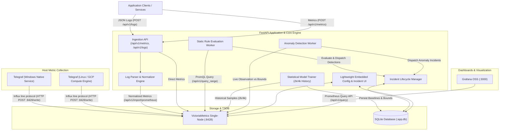
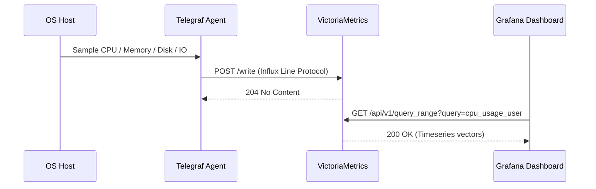
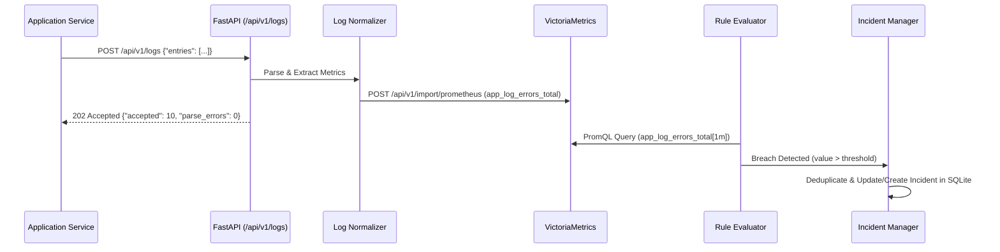
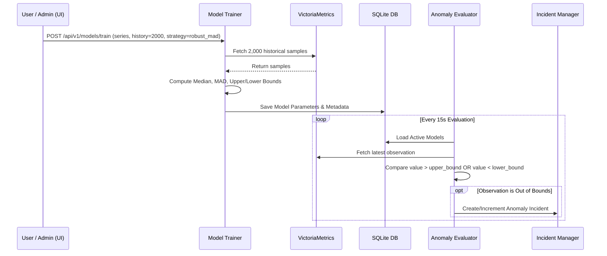

# System Architecture & Technical Specifications
## Intelligent Observability & Event Watchdog

**Document Version:** 1.0  
**Target Environment:** Windows 10/11 (Docker Desktop & Compose) | Production: GCP Compute Engine (Ubuntu 22.04 LTS / Debian)  
**Core Frameworks:** Python 3.12+, FastAPI, Uvicorn, Pydantic v2, SQLite, VictoriaMetrics, Grafana OSS, Telegraf  

---

## 1. Executive Summary & Architecture Overview

The Intelligent Observability & Event Watchdog is an API-first monitoring, metric-derivation, static threshold alerting, and statistical anomaly detection engine. It decouples high-throughput time-series data storage from transactional state management:
1. **Time-Series Metric Storage:** Single-node VictoriaMetrics handles high-velocity metric ingestion and range queries.
2. **Transactional State Storage:** SQLite stores monitoring rules, model metadata, incidents, deduplication state, and immutable audit logs.
3. **Host Metrics Collection:** Native Telegraf collector sends standard host metrics (CPU, Memory, Disk, Network) to VictoriaMetrics via InfluxDB line-protocol ingestion (`/write`).
4. **Log Metric Extraction:** FastAPI exposes `/api/v1/logs` to ingest structured or semi-structured application logs, parses them via deterministic regex/pattern extractors into normalized metric series, and flushes them to VictoriaMetrics.
5. **Detection & Lifecycle Engines:** Continuous background workers evaluate static threshold rules and statistical anomaly bounds (Rolling Mean/StdDev, Robust Median/MAD) against sliding historical windows, emitting incidents with automatic deduplication, acknowledgment, and recovery.
6. **Visualization & Operation:** Standalone Grafana provisions pre-built dashboards querying VictoriaMetrics directly via its Prometheus-compatible API (`/api/v1/query_range`), while a lightweight embedded web UI handles rule editing, model enrollment, and incident triage.

---

## 2. Component Architecture Diagram



---

## 3. Component Deep Dive & Verified Integration Protocols

### 3.1 Telegraf Host Monitoring & Ingestion Protocol Verification
- **Protocol:** VictoriaMetrics natively supports the InfluxDB line protocol over HTTP on the standard endpoint `/write`.
- **Telegraf Output Configuration:**
  ```toml
  [[outputs.http]]
    url = "http://localhost:8428/write"
    method = "POST"
    data_format = "influx"
  ```
- **Inputs Configured:**
  - `inputs.cpu`: system, user, idle, iowait
  - `inputs.mem`: total, available, used_percent
  - `inputs.disk`: used_percent, free
  - `inputs.diskio`: read_bytes, write_bytes
  - `inputs.net`: bytes_recv, bytes_sent, err_in, err_out
  - `inputs.system`: load1, load5, load15
- **Verification:** VictoriaMetrics maps Influx line protocol measurements to metric names `<measurement>_<field>` and tags to labels seamlessly, indexed in real-time.

### 3.2 Application Log Parser & Normalizer
- **Ingestion Route:** `POST /api/v1/logs` accepts single entries or batches (`{"entries": [...]}`).
- **Supported Format (MVP Standard):**
  - **Structured JSON Logs:** `{"timestamp": "ISO8601", "level": "ERROR|WARN|INFO", "service": "...", "message": "...", "status_code": 500, "duration_ms": 120}`
  - **Standard Syslog/Logfmt Pattern:** Deterministic regex extraction: `^(?P<timestamp>\S+)\s+\[(?P<level>\w+)\]\s+\[(?P<service>[\w\-]+)\]\s+(?P<message>.*)$`
- **Metric Extraction Mapping:**
  - Count of log entries grouped by `level` and `service` (`app_log_events_total`).
  - Error counts grouped by `service` (`app_log_errors_total`).
  - Latency/duration values grouped by `service` (`app_request_duration_ms`).
- **Malformed Line Handling:**
  - Malformed lines are not dropped silently.
  - They increment `app_log_parse_errors_total{service="unknown", format="unsupported"}` and are recorded in SQLite audit logs for observability.

### 3.3 VictoriaMetrics (Time-Series Database)
- **Deployment:** Single-node VictoriaMetrics (`victoriametrics/victoria-metrics:v1.101.0`).
- **Storage:** Persisted in Docker volume `vmdata:/storage-data` or local folder `./data/victoria-metrics`.
- **APIs Used:**
  - Ingestion: `/write` (Influx line protocol from Telegraf) and `/api/v1/import/prometheus` (Prometheus line format from Python app).
  - Query: `/api/v1/query` and `/api/v1/query_range` (PromQL compatible queries executed by FastAPI rule/anomaly engine and Grafana).
- **Data Retention:** Configured via `-retentionPeriod=30d`.

### 3.4 SQLite (Relational & State Store)
- **Engine:** SQLite 3 via SQLAlchemy (Async/Sync) with Write-Ahead Logging (`PRAGMA journal_mode=WAL;`).
- **Tables:**
  - `monitors`: Static threshold rules (metric, comparator, threshold, window_seconds, consecutive_breaches, consecutive_recoveries, severity, enabled).
  - `metric_enrollments`: Metric series enrolled in anomaly detection, model strategy, history size (2000 or 4000), bound multiplier (k-sigma / k-MAD), status, last_trained.
  - `model_metadata`: Model version, trained timestamp, training window start/end, baseline mean/median, scale stddev/mad, upper_bound, lower_bound, sample_count.
  - `incidents`: Unique fingerprint, detection_type (`STATIC` or `ANOMALY`), rule_or_model_id, metric_name, labels_hash, labels_json, severity, state (`OPEN`, `ACKNOWLEDGED`, `RESOLVED`), first_seen, last_seen, count, recovery_count.
  - `audit_log`: Timestamp, entity_type, entity_id, action, details_json.

### 3.5 Static Rule Engine
- **Evaluation Loop:** Background async loop running at configurable interval (default: 15s).
- **Aggregations Supported:** `avg`, `min`, `max`, `count`, `sum` over a configurable sliding window (e.g., `1m`, `5m`, `15m`).
- **Breach Criteria:** Requires `N` consecutive breaches to transition to `OPEN`.
- **Recovery Criteria:** Requires `M` consecutive healthy evaluations to transition from `OPEN`/`ACKNOWLEDGED` to `RESOLVED`.

### 3.6 Statistical Anomaly Engine
- **History Sizes Supported:** Exact 2,000 or 4,000 observations per specific series.
- **Strategies Supported:**
  1. `rolling_zscore`: Rolling Mean ($\mu$) and Standard Deviation ($\sigma$):
     $$\text{Upper} = \mu + k \cdot \sigma, \quad \text{Lower} = \max(0, \mu - k \cdot \sigma)$$
  2. `robust_mad`: Median ($\tilde{x}$) and Median Absolute Deviation ($\text{MAD} = \text{median}(|x_i - \tilde{x}|)$):
     $$\text{Upper} = \tilde{x} + k \cdot 1.4826 \cdot \text{MAD}, \quad \text{Lower} = \max(0, \tilde{x} - k \cdot 1.4826 \cdot \text{MAD})$$
- **Data Quality Safeguards:**
  - Minimum sample validation (rejects training if samples < 50).
  - Constant series detection (if $\sigma = 0$ or $\text{MAD} = 0$, baseline falls back to minimum non-zero epsilon threshold).
  - Rejects non-finite (NaN, Inf) or duplicate timestamps.

### 3.7 Incident Lifecycle & Deduplication
- **Deduplication Key (Fingerprint):**
  $$\text{Fingerprint} = \text{SHA256}(\text{detection\_type} + ":" + \text{rule\_id} + ":" + \text{metric\_name} + ":" + \text{sorted\_labels})$$
- **State Transitions:**
  ```mermaid
  stateDiagram-v2
      [*] --> OPEN : Breaches >= consecutive_breaches
      OPEN --> OPEN : Repeated Breach (Increment count, update last_seen)
      OPEN --> ACKNOWLEDGED : POST /incidents/{id}/acknowledge
      ACKNOWLEDGED --> ACKNOWLEDGED : Repeated Breach (Increment count, update last_seen)
      OPEN --> RESOLVED : Healthy Evaluations >= consecutive_recoveries
      ACKNOWLEDGED --> RESOLVED : Healthy Evaluations >= consecutive_recoveries
      RESOLVED --> OPEN : New Breach after Resolution (New Lifecycle Cycle)
  ```

### 3.8 Grafana Integration & Provisioning Verification
- **Protocol:** VictoriaMetrics is 100% compatible with Grafana's native **Prometheus data source** plugin.
- **Datasource Provisioning:**
  `grafana/provisioning/datasources/datasource.yml`:
  ```yaml
  apiVersion: 1
  datasources:
    - name: VictoriaMetrics
      type: prometheus
      access: proxy
      url: http://victoriametrics:8428
      isDefault: true
      jsonData:
        timeInterval: "10s"
  ```
- **Provisioned Dashboards (`grafana/dashboards/`):**
  1. `collection-health.json`: Host CPU, RAM, Disk, Network from Telegraf + Log Ingestion rate & Parse error rate.
  2. `anomaly-detection.json`: Live metric timeseries with superimposed Expected Baseline, Upper Bound, Lower Bound, and Anomaly Breach indicators.
  3. `alerts-incidents.json`: Gauge of Open vs Acked incidents, Incident frequency time-series, Severity distribution.

---

## 4. End-to-End Data Flows

### Flow A: Host Metric Ingestion


### Flow B: Application Log Ingestion & Metric Derivation


### Flow C: Anomaly Training & Detection Loop


---

## 5. Security & Operational Boundary
- Ingestion endpoints include payload size validation (max 5MB per log batch).
- Query parameters are bounded with strict typing via Pydantic v2.
- High-cardinality values (UUIDs, IP addresses, raw error traces) are stripped before generating metric labels.
- Environment variables configured via `.env` with strict defaults for local Docker/Windows development and GCP cloud targets.
