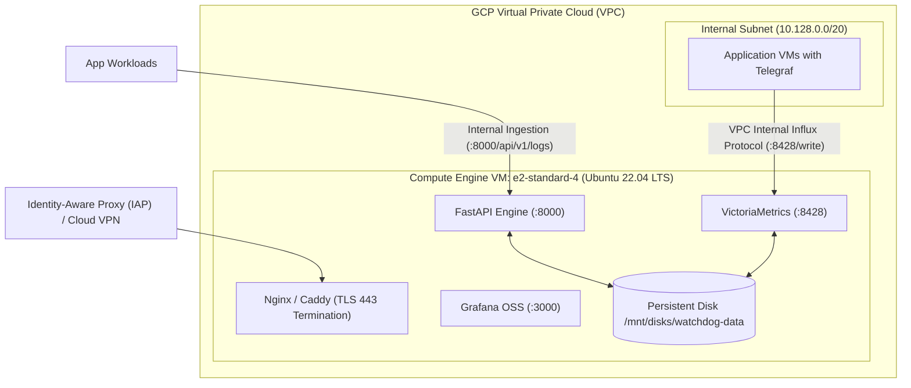

# GCP Compute Engine Deployment & Cloud Migration Guide
## Intelligent Observability & Event Watchdog

This guide provides instructions for transitioning the EventWatchdog stack from a local development workstation to **Google Cloud Platform (GCP)** using a Compute Engine Virtual Machine.

---

## 1. Cloud Architecture Overview



---

## 2. Infrastructure Provisioning (Google Cloud SDK / CLI)

### 2.1 Provision Dedicated Persistent Disk
Protect time-series and SQLite transactional state across VM restarts:
```bash
gcloud compute disks create watchdog-data-disk \
    --size=100GB \
    --type=pd-ssd \
    --zone=us-central1-a
```

### 2.2 Provision Compute Engine VM
Deploy an `e2-standard-4` instance (4 vCPU, 16 GB RAM) running Ubuntu 22.04 LTS:
```bash
gcloud compute instances create watchdog-instance \
    --zone=us-central1-a \
    --machine-type=e2-standard-4 \
    --image-family=ubuntu-2204-lts \
    --image-project=ubuntu-os-cloud \
    --disk=name=watchdog-data-disk,device-name=watchdog-data,mode=rw,boot=no \
    --tags=watchdog-server,internal-observability \
    --no-address
```
> [!IMPORTANT]
> The `--no-address` flag prevents assigning an ephemeral public IPv4 address. All administrative access should route through **Identity-Aware Proxy (IAP)** or Cloud VPN.

---

## 3. Firewall Rules & Network Restrictions

Limit network access exclusively to authorized internal subnets:

```bash
# 1. Allow internal Telegraf and Log ingestion within VPC
gcloud compute firewall-rules create allow-watchdog-internal \
    --direction=INGRESS \
    --priority=1000 \
    --network=default \
    --action=ALLOW \
    --rules=tcp:8000,tcp:8428 \
    --source-ranges=10.128.0.0/20 \
    --target-tags=watchdog-server

# 2. Allow SSH via Identity-Aware Proxy (IAP)
gcloud compute firewall-rules create allow-iap-ssh-watchdog \
    --direction=INGRESS \
    --priority=1000 \
    --network=default \
    --action=ALLOW \
    --rules=tcp:22 \
    --source-ranges=35.235.240.0/20 \
    --target-tags=watchdog-server
```

---

## 4. Persistent Storage Setup on VM

SSH into the instance via IAP:
```bash
gcloud compute ssh watchdog-instance --zone=us-central1-a --tunnel-through-iap
```

Format and mount the persistent disk:
```bash
# Format disk if first time
sudo mkfs.ext4 -m 0 -E lazy_itable_init=0,lazy_journal_init=0,discard /dev/disk/by-id/google-watchdog-data

# Create mount directory
sudo mkdir -p /mnt/disks/watchdog-data
sudo mount -o discard,defaults /dev/disk/by-id/google-watchdog-data /mnt/disks/watchdog-data
sudo chmod a+w /mnt/disks/watchdog-data

# Add to /etc/fstab for persistent mount across reboot
UUID=$(sudo blkid -s UUID -o value /dev/disk/by-id/google-watchdog-data)
echo "UUID=$UUID /mnt/disks/watchdog-data ext4 discard,defaults,nofail 0 2" | sudo tee -a /etc/fstab
```

---

## 5. Security Hardening & Secret Management

1. **Environment Configuration:**
   Never commit plain-text credentials to the repository. Use **Google Cloud Secret Manager**:
   ```bash
   gcloud secrets create watchdog-env-secret --data-file=.env
   ```
2. **TLS Termination & Reverse Proxy:**
   Deploy Nginx or Caddy on the VM with internal certificates (or Let's Encrypt if exposed to a private domain) to terminate TLS. Never expose plain HTTP ports directly to untrusted networks.
3. **Grafana Credentials:**
   Rotate default credentials via environment variables:
   ```bash
   GF_SECURITY_ADMIN_PASSWORD=$(gcloud secrets versions access latest --secret="grafana-admin-pwd")
   ```

---

## 6. Production Limitations & Migration Path

| Feature in MVP | Production Requirement for Scale |
| :--- | :--- |
| **Single-Node VictoriaMetrics** | Migrate to **VictoriaMetrics Cluster** (`vmstorage`, `vminsert`, `vmselect`) when metric ingest exceeds 500,000 samples/sec. |
| **SQLite Database** | Migrate to **Google Cloud SQL for PostgreSQL** for multi-worker distributed locking, high availability, and automated point-in-time recovery. |
| **Worker Threads** | Replace in-process asyncio workers with **Celery / Redis / Cloud Tasks** for horizontal worker scaling. |
| **Authentication** | Integrate OAuth2 / Google Workspace SSO / OIDC into FastAPI and Grafana before enterprise adoption. |
